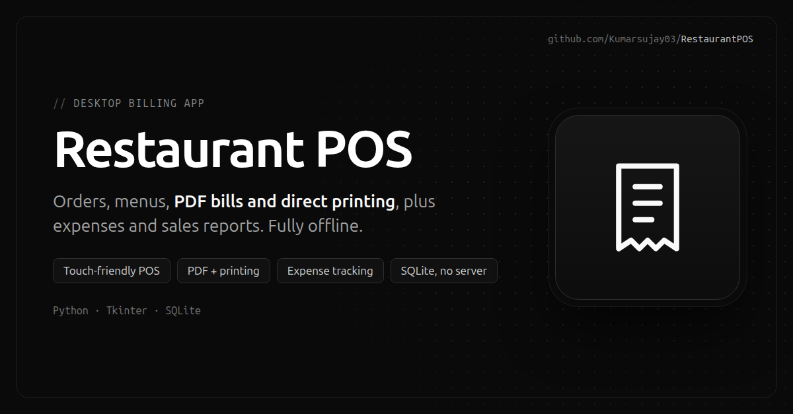

# Restaurant POS & Billing System

<p align="center"></p>

A desktop Point of Sale (POS) and billing application for restaurants, built with
Python and Tkinter. It supports menu management, order taking, bill generation,
PDF export, direct printing, expense tracking, and sales reporting. Data is stored
locally in an SQLite database, so no external server is required.

## Features

- **Point of Sale GUI** – full-screen touch-friendly interface for taking orders.
- **Menu management** – add, update, remove food items and categories.
- **Order handling** – add items, change quantities, track multiple payment
  methods (Cash, UPI, Card, Bank Transfer, Other).
- **Billing** – automatic bill numbering, on-screen bills, and PDF export.
- **Printing** – direct printing on Windows with automatic fallbacks
  (Notepad print, copy-to-PRN, standard print), plus PDF backup.
- **Reports** – view all bills, bills by date, and sales summaries.
- **Expense tracking** – record expenses and view basic profit/loss analysis.
- **Self-initializing database** – tables and sample menu data are created
  automatically on first run.
- **Command-line mode** – a terminal-based billing workflow
  (`restaurant_pos/cli.py`) is also included.

## Requirements

- Python 3.8 or newer
- Windows is recommended for full printing support. The application runs on other
  platforms, but the Windows-only printing libraries (`pywin32`, `wmi`) are
  skipped and PDF export is used instead.

Python dependencies are listed in [`requirements.txt`](requirements.txt).
`tkinter`, `sqlite3`, `datetime`, and `pathlib` ship with the Python standard
library and do not need to be installed separately.

## Installation

```bash
# Clone the repository
git clone https://github.com/Kumarsujay03/RestaurantPOS.git
cd RestaurantPOS

# (Optional) create a virtual environment
python -m venv .venv
# Windows
.venv\Scripts\activate
# macOS / Linux
source .venv/bin/activate

# Install dependencies
pip install -r requirements.txt
```

Optionally, install the project as a package (this also creates the
`restaurant-pos` and `restaurant-pos-cli` commands):

```bash
pip install -e .
```

## Configuration

Edit [`restaurant_pos/core/config.py`](restaurant_pos/core/config.py) to
set your restaurant name, address, contact details, tagline, and bill options
(prefix, footer message, optional GST/service charge). These values appear on
generated bills.

## Usage

### Graphical POS (recommended)

From the project root:

```bash
python run_pos.py
```

If you installed the package with `pip install -e .`, you can instead run:

```bash
restaurant-pos
```

- Press `F11` to toggle full-screen, `Esc` to exit full-screen.
- The database (`restaurant.db`) and the `bills/` folder are created
  automatically on first run, along with a sample menu.

### Command-line billing

```bash
python -m restaurant_pos.cli        # after `pip install -e .`
# or
restaurant-pos-cli
```

A text-based menu for creating bills, searching, and viewing sales summaries.

> Running the package as a module requires the project root on the Python
> path, which `pip install -e .` handles automatically. Without installing,
> use `python run_pos.py` for the GUI.

## Building a Standalone Executable (Windows)

A helper script uses PyInstaller to produce a single `.exe`:

```bash
pip install pyinstaller
python scripts/build.py
```

The executable is written to `dist/RestaurantPOS.exe`. You can also run
`scripts/build.bat` on Windows.

## Project Structure

```
.
├── run_pos.py                     # Convenience GUI launcher (project root)
├── pyproject.toml                 # Packaging metadata and entry points
├── requirements.txt               # Python dependencies
├── restaurant_pos/                # Application package
│   ├── app.py                     # GUI entry point
│   ├── cli.py                     # Command-line entry point
│   ├── core/                      # Data access and business logic (no GUI)
│   │   ├── config.py              # Restaurant details and bill settings
│   │   ├── database.py            # SQLite schema and initialization
│   │   ├── food_manager.py        # Food item and category data access
│   │   ├── billing_system.py      # Bill creation, storage, printing
│   │   ├── printer_utils.py       # Printer detection, printing, PDF export
│   │   └── path_utils.py          # Filesystem paths (dev and packaged)
│   └── gui/                       # Tkinter user interface
│       ├── pos_gui.py             # Main POS window
│       ├── menu_display.py        # Menu rendering and category browsing
│       ├── order_manager.py       # Current order and customer info
│       ├── bill_dialogs.py        # Bill-related dialog windows
│       ├── bill_reports.py        # Reports (all bills, by date, summary)
│       ├── management_gui.py      # Restaurant/menu management interface
│       ├── expense_manager.py     # Expense tracking and profit/loss
│       └── gui_components.py      # Shared styles and reusable widgets
├── scripts/
│   ├── build.py                   # PyInstaller build script
│   ├── build.bat                  # Windows build helper
│   └── version_info.txt           # Windows executable version metadata
└── bills/                         # Generated bills (created at runtime)
```

## Data & Privacy

- `restaurant.db` and the contents of `bills/` are generated at runtime and are
  excluded from version control via `.gitignore`. They may contain customer data,
  so keep them out of public repositories.

## License

Released under the MIT License. See [LICENSE](LICENSE).
